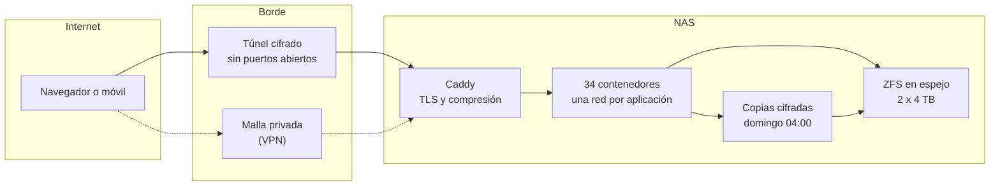

# Kura

**Documentación de diseño, operación y evolución de un servidor doméstico autoalojado: nube personal, correo, calendario, fotos, contraseñas, automatización y copias, todo en una sola máquina y sin un solo puerto abierto en el router.**

Este repositorio cuenta qué corre en el NAS, cómo está montado, cómo pasó de "funciona si no lo tocas" a algo que se puede actualizar un domingo por la mañana sin miedo, qué se rompió por el camino y hacia dónde va.

[Ver la demo](https://iveliank.github.io/Kura/demo/) · [El sistema](docs/00-el-sistema.md) · [Arquitectura](docs/03-arquitectura.md) · [Tropiezos](docs/08-tropiezos.md)

---

## Qué es

Una máquina en casa que sustituye a la mayor parte de lo que normalmente se alquila a Google, Apple o Microsoft:

1. **Archivos y documentos.** Nube propia con edición de ofimática en el navegador, sincronizada con el PC y el móvil.
2. **Correo y agenda.** Un único webmail con tres cuentas de tres proveedores distintos, firmas por identidad y autocompletado; un calendario que se sincroniza en los dos sentidos con Google cada minuto.
3. **Fotos.** Copia automática del móvil con búsqueda por contenido y caras, más de 14.000 fotos y vídeos.
4. **Contraseñas.** Gestor propio compatible con los clientes oficiales.
5. **Automatización y casa.** Flujos programados, domótica y un panel que lo resume todo en una pantalla.
6. **Copias.** Volcados de bases de datos y copias cifradas con deduplicación, programadas cada domingo de madrugada.

Quién lo usa:

| Perfil | Qué hace en él |
|---|---|
| Yo, como usuario | Correo, calendario, fotos, documentos, contraseñas |
| Yo, como administrador | Despliega, actualiza, vigila y restaura |
| Otros equipos de casa | Sincronizan carpetas con versionado |
| Internet | Solo lo que pasa por el túnel cifrado y su control de acceso |

> **Sobre los datos.** Este repositorio no menciona dominios, direcciones IP, cuentas, correos, teléfonos, empresas, versiones exactas ni qué servicios están expuestos; la topología de la demo es ilustrativa. Ningún secreto aparece en estos ficheros, ni siquiera caducado. Algunas cifras están redondeadas o son ilustrativas. No hay capturas del panel real: la demo está construida desde cero con datos inventados.
>
> **Sobre el nombre.** Un *kura* es el almacén tradicional japonés: muros gruesos de barro, puertas pesadas y una sola función, que lo valioso sobreviva aunque arda la casa de al lado. Este servidor tiene la misma vocación, y la documentación cuenta también cuándo falló.

## En una imagen



## Estado

| | |
|---|---|
| Situación | En producción, uso diario |
| Hardware | Ryzen 5 7600X, 32 GB de RAM, 2 discos de 4 TB en espejo ZFS, SSD de arranque |
| Sistema | TrueNAS SCALE con Docker, pilas gestionadas desde Dockge |
| Contenedores | 34 en marcha, 0 con reinicios, 0 con imagen desfasada tras la última revisión |
| Exposición | Todo detrás de un túnel saliente; 0 puertos abiertos en el router |
| Copias | 3 programaciones, 2 copias como máximo por trabajo, restauración ensayada |
| Disponibilidad de la nube | 99,94 % en los últimos 90 días, con dos paradas planificadas |
| Consumo | Unos 48 W en reposo |

## Cómo leer esta documentación

| # | Documento | De qué va |
|---|---|---|
| 0 | [El sistema](docs/00-el-sistema.md) | Todo lo que corre, por áreas |
| 1 | [Punto de partida](docs/01-punto-de-partida.md) | Cómo estaba antes de ponerle orden |
| 2 | [Línea del tiempo](docs/02-linea-del-tiempo.md) | Qué pasó y cuándo |
| 3 | [Arquitectura](docs/03-arquitectura.md) | Red, almacenamiento, exposición y por qué así |
| 4 | [Rendimiento](docs/04-rendimiento.md) | Sacar velocidad a dos discos duros lentos |
| 5 | [Correo y calendario](docs/05-correo-y-calendario.md) | Tres cuentas en una bandeja y Google sincronizado en los dos sentidos |
| 6 | [Seguridad](docs/06-seguridad.md) | Lo que estaba mal, cómo apareció y qué se hizo |
| 7 | [Copias](docs/07-copias.md) | Qué se copia, cuándo, cuánto se guarda y cómo se restaura |
| 8 | [Tropiezos](docs/08-tropiezos.md) | Fallos reales en formato postmortem sin culpables |
| 9 | [Lo aprendido](docs/09-lecciones.md) | Lo que haría igual y lo que no |
| 10 | [Hoja de ruta](docs/10-hoja-de-ruta.md) | NVMe, discos de NAS, copia fuera de casa y lo que viene |
| - | [Registro de decisiones](docs/decisiones/README.md) | Las decisiones importantes, una por fichero |

Si solo tienes cinco minutos: este README, [la arquitectura](docs/03-arquitectura.md) y [los tropiezos](docs/08-tropiezos.md).

## La demo

**[Abrir la demo](https://iveliank.github.io/Kura/demo/)**. Reproduce el panel de control del NAS con datos inventados y añade lo que el panel real no enseña.

| Pestaña | Qué enseña |
|---|---|
| Panel | Los servicios por áreas con su estado, carga y memoria en vivo, en la misma rejilla del panel real |
| Red | El camino de una petición desde internet hasta su contenedor, con las redes aisladas; pulsa un servicio para ver su ruta |
| Copias | El calendario de domingos, qué entra en cada trabajo y cómo funciona la retención de dos copias; lanza una copia y mira cómo deduplica |
| Bitácora | Cada cambio y cada incidente, filtrable, con su vuelta atrás |

Atajos: <kbd>1</kbd> a <kbd>4</kbd> cambian de pestaña, <kbd>/</kbd> busca un servicio.

### Desplegarla

Todo explicado en la [guía de despliegue](deploy/README.md):

```bash
docker run -d --name kura-demo -p 127.0.0.1:8080:8080 --read-only --tmpfs /tmp --cap-drop ALL --security-opt no-new-privileges:true --restart unless-stopped ghcr.io/iveliank/kura-docs-demo:latest
```

El paquete trae `Dockerfile` con nginx sin privilegios y CSP estricta, `docker-compose.yml` endurecido y un workflow que publica la imagen en GitHub Packages para amd64 y arm64.

## Stack

| Capa | Tecnología |
|---|---|
| Sistema y almacenamiento | TrueNAS SCALE, ZFS en espejo, instantáneas |
| Contenedores | Docker, Dockge, Arcane |
| Borde y red | Túnel saliente, Caddy, AdGuard Home, VPN de malla |
| Nube y ofimática | Nextcloud, PostgreSQL, Valkey, OnlyOffice Docs, Imaginary |
| Correo y agenda | SnappyMail con tema propio, vdirsyncer |
| Fotos | Immich con aprendizaje automático local |
| Contraseñas | Vaultwarden |
| Automatización y casa | n8n, Home Assistant |
| Copias | Zerobyte (restic), volcados de bases de datos programados |
| Panel | Homepage con CSS y JS propios |
| Sincronización de equipos | Syncthing |

## Cinco ideas que resumen el proyecto

1. El cuello de botella casi nunca es el software. Aquí eran dos discos SMR de sobremesa, y ningún ajuste lo esconde del todo; lo que sí se puede es dejar de pedirles trabajo inútil.
2. Una interfaz única no exige un único programa: exige que todo se vea desde el mismo sitio. Nextcloud se quedó; su correo no.
3. Una copia que no se ha restaurado nunca es una esperanza, no una copia.
4. Los secretos no se filtran por un ataque, se filtran por un `cat` del fichero equivocado. Fuera del `compose.yaml`, siempre.
5. Quitar es una mejora. Cuatro aplicaciones y 24 GB de imágenes fuera dejaron el sistema más rápido y más fácil de entender que cualquier cosa añadida.

## Autor

Diseñado, montado y mantenido por [Ivelian](https://github.com/IvelianK). También en este perfil: [Kintsugi](https://github.com/IvelianK/Kintsugi), la documentación de una plataforma de gestión de servicio técnico de campo.

## Licencia

Documentación bajo [CC BY 4.0](https://creativecommons.org/licenses/by/4.0/deed.es). Código de la demo y del despliegue bajo MIT. Detalle en [LICENSE](LICENSE).
