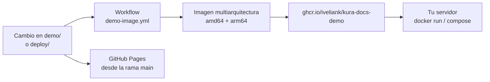

# Desplegar la demo

La demo son tres ficheros estáticos (`index.html`, `styles.css`, `app.js`). No tiene backend, base de datos ni llamadas de red: cualquier servidor web la sirve. Esta guía cubre de la opción más simple a la más controlada.

| Opción | Para qué | Tiempo |
|---|---|---|
| [1. Abrirla en local](#1-abrirla-en-local) | Verla en tu equipo | 10 segundos |
| [2. GitHub Pages](#2-github-pages) | Enlace público gratuito | 2 minutos |
| [3. Contenedor publicado](#3-contenedor-publicado) | Servidor propio con Docker | 1 minuto |
| [4. Docker Compose](#4-docker-compose) | Servidor propio, arranque persistente | 2 minutos |
| [5. Paquete zip](#5-paquete-zip) | Subirla a cualquier hosting | 5 minutos |
| [6. Otros servicios estáticos](#6-otros-servicios-estáticos) | Netlify, Cloudflare Pages, S3 | 5 minutos |

## Qué hay en el paquete

```
deploy/
├── Dockerfile           imagen nginx sin privilegios con la demo dentro
├── nginx.conf           cabeceras de seguridad, compresión, caché y /healthz
├── docker-compose.yml   arranque con el contenedor endurecido
└── README.md            esta guía
.dockerignore            la imagen solo recibe demo/ y nginx.conf
demo/
├── index.html
├── styles.css
└── app.js
.github/
├── workflows/
│   └── demo-image.yml   prueba el contenedor, publica la imagen y el zip en cada versión
└── dependabot.yml       mantiene al día las acciones y la imagen base
SECURITY.md              cómo informar de una vulnerabilidad
```



## 1. Abrirla en local

Doble clic en `demo/index.html`. Funciona sin servidor.

Si el navegador limita algo al abrir ficheros locales, sírvela por HTTP:

```bash
python -m http.server 8080 --directory demo
```

Y abre http://localhost:8080.

## 2. GitHub Pages

1. Haz un fork del repositorio.
2. En el fork: **Settings → Pages → Build and deployment**.
3. Source: **Deploy from a branch**. Rama `main`, carpeta `/ (root)`. Guarda.
4. En uno o dos minutos la demo estará en `https://<tu-usuario>.github.io/<repositorio>/demo/`.

Desde la terminal, con `gh` y sesión iniciada:

```bash
gh api -X POST repos/<tu-usuario>/<repositorio>/pages -f "source[branch]=main" -f "source[path]=/"
```

GitHub Pages no permite cabeceras propias. La CSP viaja también en una etiqueta `<meta>` de `index.html`, así que se aplica igual; el resto de cabeceras (nosniff, Referrer-Policy, protección contra incrustación) solo las tienes con el contenedor.

## 3. Contenedor publicado

La imagen se publica sola en GitHub Packages. Es multiarquitectura: amd64 y arm64 (sirve en una Raspberry Pi con sistema de 64 bits; las de 32 bits no).

```bash
docker run -d --name kura-demo -p 127.0.0.1:8080:8080 --read-only --tmpfs /tmp --cap-drop ALL --security-opt no-new-privileges:true --restart unless-stopped ghcr.io/iveliank/kura-docs-demo:latest
```

Publica solo en `127.0.0.1`; para exponerla en la red usa `-p 8080:8080`, a sabiendas de que Docker se salta el cortafuegos. Abre http://localhost:8080. Comprobación:

```bash
curl -s http://localhost:8080/healthz
```

Debe responder `ok`.

Etiquetas disponibles: `latest` (rama principal), `X.Y.Z` (cada versión publicada) y `sha-xxxxxxx` (cada commit). En producción, fija una versión en lugar de `latest`.

## 4. Docker Compose

Desde la raíz del repositorio:

```bash
docker compose -f deploy/docker-compose.yml up -d
```

Por defecto solo escucha en `127.0.0.1`, pensado para tener un proxy con HTTPS delante. Para otro puerto, o para exponerla directamente en la red (Docker se salta el cortafuegos del sistema, así que hazlo a sabiendas):

```bash
DEMO_PORT=9000 DEMO_BIND=0.0.0.0 docker compose -f deploy/docker-compose.yml up -d
```

Para actualizar a la última imagen publicada:

```bash
docker compose -f deploy/docker-compose.yml pull
```

Para usar una imagen construida desde tu copia del código (por ejemplo, en un fork con cambios):

```bash
docker build -f deploy/Dockerfile -t kura-demo:local .
```

```bash
DEMO_IMAGE=kura-demo:local docker compose -f deploy/docker-compose.yml up -d
```

Para pararla y borrar el contenedor (los ficheros de la demo no se tocan):

```bash
docker compose -f deploy/docker-compose.yml down
```

### Detrás de un proxy con HTTPS

El contenedor escucha en HTTP en el puerto 8080. Ponlo detrás de tu proxy de siempre. Con Caddy, que gestiona el certificado solo:

```
demo.tudominio.com {
    reverse_proxy 127.0.0.1:8080
}
```

Con el compose ya publica solo en `127.0.0.1`, así que no queda expuesto sin TLS.

## 5. Paquete zip

Cada versión publicada en [Releases](https://github.com/IvelianK/Kura/releases) incluye `kura-demo-<versión>.zip` con la demo lista para subir, esta carpeta `deploy/` y la licencia. Lo genera el workflow al crear una etiqueta `v*`.

1. Descarga el zip y descomprímelo.
2. Sube el contenido de `demo/` a la raíz pública de tu hosting (por FTP, panel de control o lo que uses).
3. Si tu hosting usa nginx, toma las cabeceras de `deploy/nginx.conf`. Si usa Apache, el equivalente en un `.htaccess`:

```apache
Header always set Content-Security-Policy "default-src 'none'; script-src 'self'; style-src 'self'; img-src 'self' data:; base-uri 'none'; form-action 'none'; frame-ancestors 'none'"
Header always set X-Content-Type-Options "nosniff"
Header always set Referrer-Policy "no-referrer"
Header always set Permissions-Policy "camera=(), microphone=(), geolocation=(), payment=()"
Header always set Cross-Origin-Opener-Policy "same-origin"
```

## 6. Otros servicios estáticos

| Servicio | Cómo |
|---|---|
| Netlify | Arrastra la carpeta `demo/` a app.netlify.com/drop |
| Cloudflare Pages | Proyecto nuevo, sin comando de build, directorio de salida `demo` |
| Vercel | `vercel deploy demo --prod` |
| Amazon S3 + CloudFront | Sube `demo/` al bucket, CloudFront delante con política de cabeceras de seguridad |

## Seguridad del contenedor

| Medida | Dónde |
|---|---|
| nginx sin root (usuario 101) | Imagen base `nginx-unprivileged` |
| Sistema de ficheros de solo lectura | `read_only: true`, solo `/tmp` escribible en memoria |
| Sin capacidades del kernel | `cap_drop: ALL` |
| Sin escalada de privilegios | `no-new-privileges` |
| CSP sin `unsafe-inline` | `nginx.conf`. La demo no tiene scripts ni estilos en línea por eso |
| Sin versión del servidor en las cabeceras | `server_tokens off` |
| Comprobación de salud | `/healthz` y `HEALTHCHECK` en el Dockerfile |
| Prueba antes de publicar | El workflow arranca el contenedor con estas opciones y comprueba respuestas, cabeceras y usuario antes de subir la imagen |

## Problemas frecuentes

| Síntoma | Causa | Solución |
|---|---|---|
| `port is already allocated` | El puerto 8080 está ocupado | Usa otro: `-p 9000:8080` o `DEMO_PORT=9000` |
| La página carga sin estilos | Se subió `index.html` sin `styles.css` | Sube la carpeta `demo/` completa |
| En Windows con Git Bash, `--tmpfs /tmp` falla con "mount path must be absolute" | Git Bash convierte `/tmp` en una ruta de Windows | Antepón `MSYS_NO_PATHCONV=1` al comando, o usa PowerShell |
| `pull access denied` al descargar la imagen | El paquete aún no es público | Ver [paquete privado](#si-la-imagen-pide-credenciales) |

### Si la imagen pide credenciales

Los paquetes nuevos de GitHub nacen privados. Para hacerlo público: en el perfil, **Packages → kura-docs-demo → Package settings → Change visibility → Public**.
