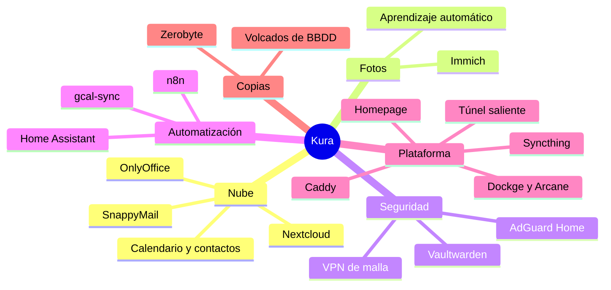

# 0. El sistema

Todo lo que corre en el NAS, agrupado como lo agrupa el panel. Cada aplicación vive en sus contenedores, con su propia red y su propia carpeta de datos en el pool. Ninguna publica puertos a internet.

## Vista general

## Por áreas

### Nube personal

| Servicio | Qué hace | Detalle que importa |
|---|---|---|
| Nextcloud | Archivos, calendario, contactos, notas, tareas, kanban | PostgreSQL, Valkey para caché y bloqueos, APCu, OPcache con JIT, cron cada minuto |
| OnlyOffice Docs | Edición de documentos, hojas y presentaciones en el navegador | Habla con Nextcloud por la red interna, sin salir a internet |
| SnappyMail | Webmail dentro de Nextcloud | Sustituye a la app Mail oficial. Varias cuentas, firmas HTML por identidad, tema oscuro propio |
| Imaginary | Miniaturas de imágenes y PDF | Libera a PHP de generar previsualizaciones |

### Fotos

| Servicio | Qué hace | Detalle que importa |
|---|---|---|
| Immich | Copia automática del móvil, álbumes, búsqueda | 12.713 fotos y 1.473 vídeos, 224 GB de originales |
| Immich ML | Caras y búsqueda por contenido | Todo en local, ninguna foto sale de casa |

### Seguridad

| Servicio | Qué hace | Detalle que importa |
|---|---|---|
| Vaultwarden | Gestor de contraseñas | Compatible con los clientes oficiales de Bitwarden |
| AdGuard Home | DNS de la casa y bloqueo de publicidad | Reescrituras para que los dominios propios resuelvan en local desde dentro |
| VPN de malla | Acceso privado desde fuera | Para lo que nunca debe pasar por el túnel público |

### Automatización y casa

| Servicio | Qué hace | Detalle que importa |
|---|---|---|
| n8n | Flujos programados | Con su propio PostgreSQL y Valkey |
| Home Assistant | Domótica | Lee el estado del NAS para sus propias automatizaciones |
| gcal-sync | Calendario de Nextcloud y Google en los dos sentidos | vdirsyncer, cada minuto |

### Plataforma

| Servicio | Qué hace |
|---|---|
| Caddy | Proxy inverso: TLS automático, compresión zstd y gzip, cabeceras de seguridad |
| Túnel saliente | Conexión iniciada desde el NAS hacia el borde, la única puerta de entrada desde internet |
| Dockge | Pilas de Docker Compose editables desde el navegador |
| Arcane | Inventario y estado de contenedores |
| Homepage | Panel único con el estado de todo, con diseño propio |
| Securo, Caddy Manager, MediaCompressor | Utilidades propias |
| Syncthing | Sincroniza carpetas de otros equipos con el NAS, con versionado escalonado |

### Copias

| Servicio | Qué hace |
|---|---|
| Zerobyte | Interfaz y programador sobre restic: repositorio cifrado y deduplicado |
| Volcados | Script de TrueNAS que vuelca las cinco bases de datos cada domingo a las 03:30 |

## Lo que ya no está

| Quitado | Por qué |
|---|---|
| App Mail de Nextcloud | Sin avisos al instante, lenta, y guardaba credenciales en la base de datos. Borrada con sus 21 tablas |
| Cloudreve, WhoDB, Adminer, Homelable | Sin uso. Cada una era una superficie más expuesta, dos de ellas con acceso directo a bases de datos |
| Jellyfin, Jellyseerr, Stirling PDF, Bazarr, Zurg | Restos de pruebas antiguas. Solo quedaban sus imágenes |
| Un webmail propio | Se construyó, funcionaba, y se borró el mismo día. Contado en [la decisión 0003](decisiones/0003-tema-propio-no-webmail-propio.md) |
| openGym | Instalado, publicado y retirado por completo en la misma tarde, sin dejar rastro |
| `google_synchronization` | App de Nextcloud que rompió una actualización. Apartada |

## Cifras

| | |
|---|---|
| Espacio de Docker | 43,2 GB antes de la limpieza, 19 GB después |
| Contactos | 4 antes de importar, 141 después |
| Calendario | 2 calendarios sincronizados en los dos sentidos, retraso medio de 20 a 60 segundos |
| Peso del editor de documentos | 28,9 MB por apertura sin caché antes, 5,1 MB después |
| Sesiones activas conservadas al rotar un secreto | 113 de 113 |

---

Siguiente: [Punto de partida](01-punto-de-partida.md)
