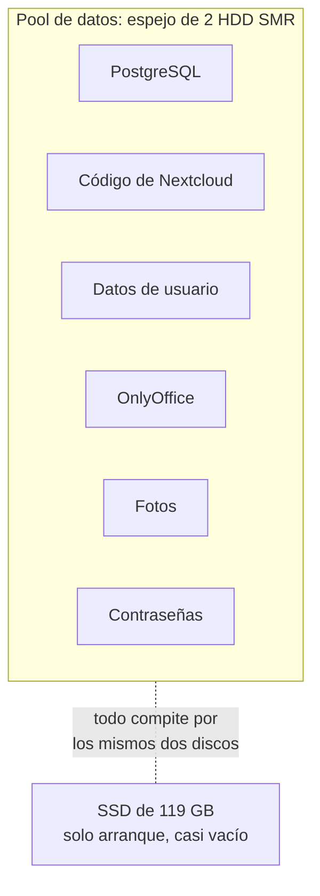

# 1. Punto de partida

El NAS funcionaba, pero no lo bastante bien como para fiarse de él.

## Cómo estaba

| Área | Situación |
|---|---|
| Discos | Dos discos de sobremesa SMR en espejo. Buenos para guardar, malos para bases de datos. Todo vivía ahí: Postgres, el código de PHP, OnlyOffice, las fotos |
| Nextcloud | Bien montado por dentro (Valkey, APCu, Postgres), pero con el cron cada 5 minutos, OPcache de 128 MB y `overwrite.cli.url` apuntando a `localhost` |
| OnlyOffice | Cada apertura sin caché descargaba 28,9 MB de JavaScript sin comprimir |
| Correo | La app Mail de Nextcloud: sin IMAP IDLE, sincronizando por cron. Una de las cuentas iba **sin cifrar**, con usuario y contraseña en claro contra una IP pública |
| Calendario | Nextcloud por un lado, Google por otro, sin hablarse |
| Secretos | Contraseñas en claro en los `compose.yaml`. Una misma contraseña reutilizada como clave de Valkey, de Postgres (tres veces) y de administrador |
| Web personal | Caída desde fuera con un 502. El túnel y el contenedor estaban en redes distintas y no se veían: 136.000 errores acumulados en el log sin que nadie mirase |
| Copias | Instantáneas mensuales de algunos conjuntos de datos. El gestor de contraseñas y la base de datos de Nextcloud, **sin ninguna** |
| Aplicaciones | Cuatro sin uso con su proxy, su DNS y su tarjeta en el panel. Dos de ellas eran clientes web de bases de datos |
| Panel | Útil, pero plano y con huecos, y con enlaces repetidos |

## Por qué no bastaba con ir arreglando

Cada punto de la tabla se podía arreglar por separado, y de hecho así se hizo. Lo que faltaba no era un arreglo, era un criterio común:

- **Velocidad**: no comprar nada todavía y quitar trabajo inútil a los discos.
- **Seguridad**: ningún secreto en un fichero que se muestra, ninguna credencial viajando en claro, nada expuesto que no se use.
- **Fiabilidad**: copias que cubran lo que de verdad duele perder, con retención corta y comprobadas.
- **Cambios**: todo con copia previa y con la vuelta atrás escrita antes de empezar, en caliente siempre que se pueda.

El resto de la documentación cuenta cómo se aplicó.

---

Anterior: [El sistema](00-el-sistema.md) · Siguiente: [Línea del tiempo](02-linea-del-tiempo.md)
