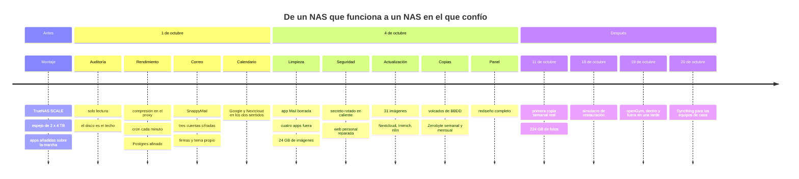
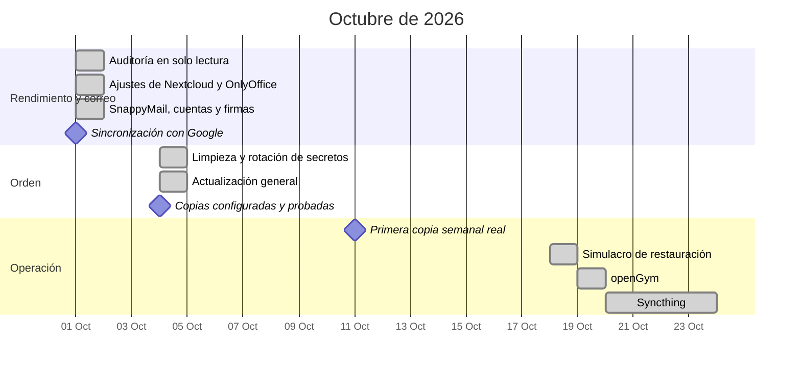
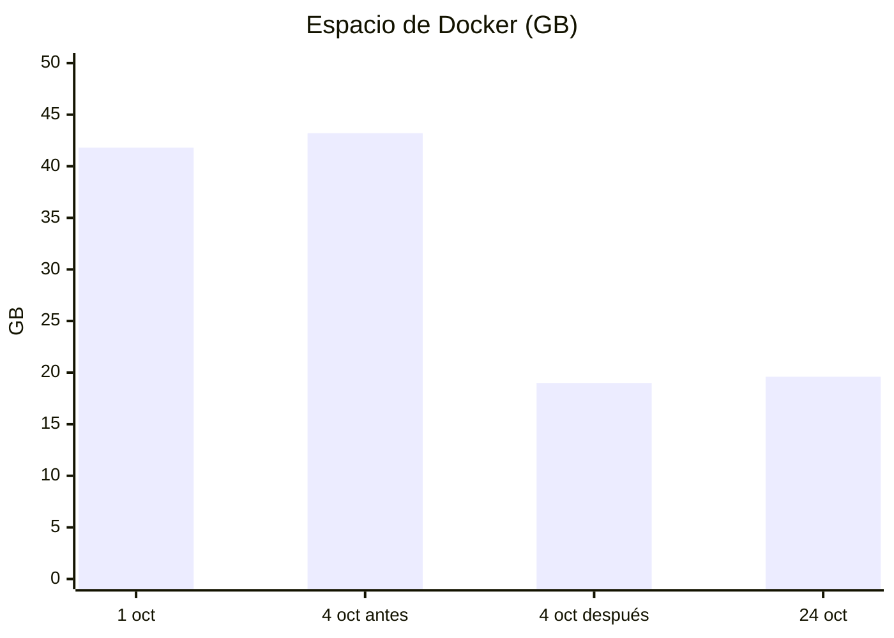
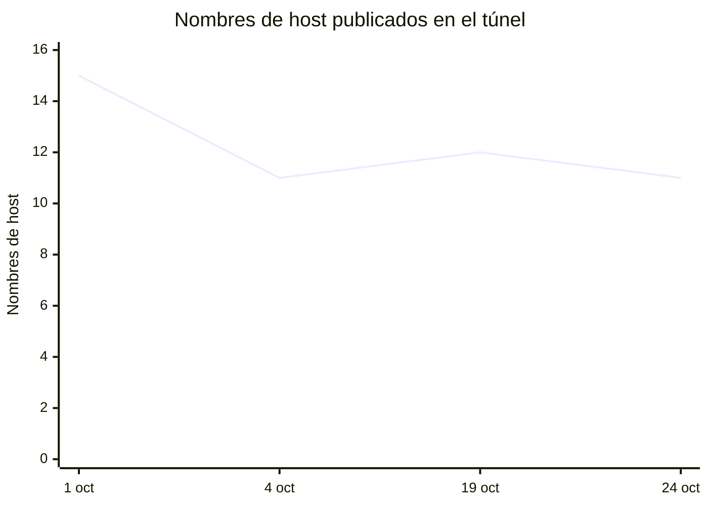

# 2. Línea del tiempo

La mayor parte del trabajo cabe en tres jornadas largas de octubre de 2026, porque trabajé con un asistente de IA con acceso de administrador al NAS, primero en solo lectura para auditar y después aplicando cambios con copia previa. La regla fue siempre la misma: el asistente propone, enseña la vuelta atrás y espera; yo decido. Varias de sus propuestas no salieron adelante, y en un par de ocasiones fui yo quien paró a mitad.

## Vista general

## En un diagrama de Gantt

## Cómo cambió el sistema

Espacio ocupado por Docker. La limpieza del 4 de octubre fue la mejora más grande del mes y no añadió nada.

Y el número de servicios expuestos a internet, que es la cifra que de verdad mide la superficie de ataque:

## Los hitos, contados

**1 de octubre, mañana.** Empezó con una pregunta sencilla: si el correo de Nextcloud podía ser instantáneo y OnlyOffice "mil veces más rápido". La respuesta fue que no, y por qué. Una auditoría en solo lectura por la API de TrueNAS dejó claro el techo: todo, base de datos incluida, vivía en dos discos SMR. La CPU estaba al 0,2 de carga.

**1 de octubre, tarde.** Sin comprar hardware: compresión en Caddy (el editor de documentos bajó de 28,9 a 5,1 MB), cron cada minuto, OPcache a 256 MB, Postgres con menos sincronización a disco, OnlyOffice hablando con Nextcloud por la red interna. Después, SnappyMail en lugar de la app Mail, con tres cuentas que antes iban mal configuradas o sin cifrar, firmas por identidad y autocompletado de destinatarios.

**1 de octubre, tarde y noche.** El tema visual. Pedí algo oscuro, elegante y ordenado; primero salió un webmail entero hecho desde cero, que no era lo que quería, y después un tema para SnappyMail, que sí. Luego, el calendario: un contenedor con vdirsyncer que sincroniza Nextcloud y Google en los dos sentidos cada minuto.

**4 de octubre.** El día del orden. La app Mail borrada con sus credenciales, la web personal reparada tras semanas caída, el secreto de Valkey rotado sin cerrar una sola sesión, 137 contactos importados, cuatro aplicaciones eliminadas con todos sus restos, 31 imágenes actualizadas (Immich con un salto de versión mayor), las copias programadas y probadas, y el panel rediseñado dos veces.

**11 de octubre.** La primera copia semanal real. Tardó varias horas porque subía las fotos completas por primera vez. Las siguientes son incrementales y duran minutos.

**18 de octubre.** Simulacro de restauración. Vaultwarden y la base de datos de Nextcloud levantados desde la copia en un entorno aparte, y comparados con los vivos. Contado en [Copias](07-copias.md#el-simulacro).

**19 de octubre.** openGym instalado, publicado con certificado real y retirado del todo esa misma tarde por decisión mía. Un buen ensayo de que el sistema admite añadir y quitar piezas limpiamente.

**20 de octubre.** Syncthing en el NAS. Empieza a servir también a los demás equipos de la casa.

**Lo siguiente.** Está en la [hoja de ruta](10-hoja-de-ruta.md).

---

Anterior: [Punto de partida](01-punto-de-partida.md) · Siguiente: [Arquitectura](03-arquitectura.md)
