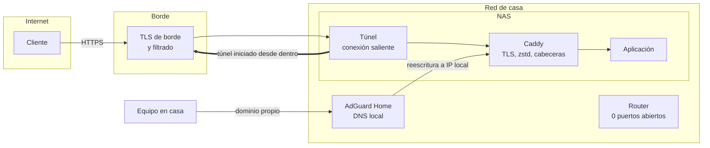
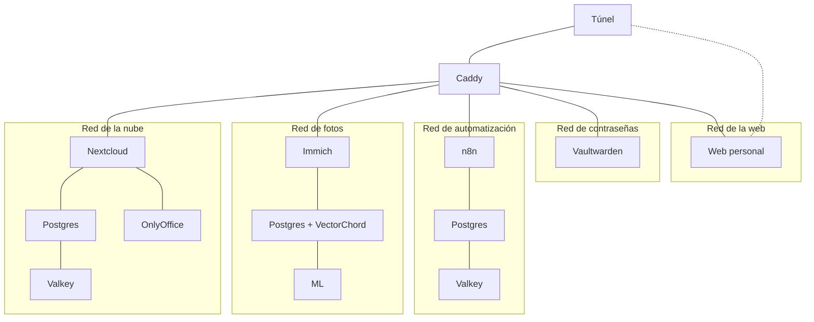
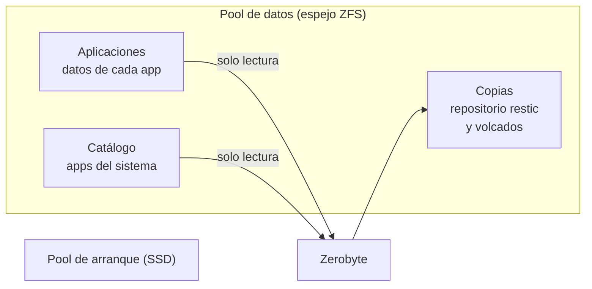

# 3. Arquitectura

Tres preguntas definen la arquitectura de un servidor en casa: por dónde entra el tráfico, cómo se aíslan las aplicaciones entre sí y dónde viven los datos. Las tres respuestas están pensadas para que un fallo en una pieza no arrastre a las demás.

## Por dónde entra el tráfico

- **Desde fuera**, el router no tiene ningún puerto abierto. El túnel abre una conexión saliente al borde y el tráfico baja por ella. Ni la IP de casa ni los puertos son visibles. Ver [la decisión 0005](decisiones/0005-tunel-sin-puertos-abiertos.md).
- **Desde dentro**, AdGuard reescribe los dominios propios a la IP local del NAS. El portátil en el sofá no sale a internet para abrir un documento de la habitación de al lado.
- **Para administrar**, una VPN de malla. Lo que no debe estar en el túnel público solo se alcanza por ella.

## Cómo se aíslan las aplicaciones

Cada aplicación tiene su propia red de Docker. Sus bases de datos solo están en esa red y no publican puertos. Caddy es el contenedor unido a varias redes y el que recibe casi todo el tráfico del túnel. La excepción es la web personal: el túnel está unido a su red y llega a ella directamente.

La consecuencia buena: si una aplicación se ve comprometida, no ve las bases de datos de las demás. La consecuencia mala, que cuento en [Tropiezos](08-tropiezos.md#la-web-que-nadie-veía): si te olvidas de unir el proxy o el túnel a la red de una aplicación nueva, la aplicación existe pero nadie llega a ella. Ver [la decisión 0006](decisiones/0006-una-red-por-aplicacion.md).

## Dónde viven los datos

| Conjunto de datos | Qué guarda | Política |
|---|---|---|
| Aplicaciones | Una carpeta por aplicación: datos, configuración, temas | Copia semanal o mensual según importancia |
| Catálogo | Aplicaciones instaladas desde el catálogo de TrueNAS | Volcado de BBDD semanal |
| Copias | Repositorio cifrado y volcados | Destino de copias, nunca origen |
| Arranque | El sistema operativo | No se usa para datos. TrueNAS no lo soporta bien |

Zerobyte monta los orígenes en **solo lectura**. Un fallo del programa de copias no puede borrar lo que copia.

## Panel único

Homepage lee el estado de cada servicio (por la API de TrueNAS, de Docker y de cada aplicación) y lo pinta en una rejilla. El diseño es propio: CSS y un poco de JS inyectados, la misma paleta oscura con acento ámbar que el correo, para que todo parezca una sola herramienta. Detalle en [la decisión 0009](decisiones/0009-un-solo-lenguaje-visual.md).

## Cómo se cambia algo

No hay CI para la casa, pero sí un procedimiento que no se salta:

1. **Leer antes de tocar.** Auditoría en solo lectura y versión exacta de lo que hay.
2. **Copia previa** del fichero o del valor que se va a cambiar, con fecha en el nombre.
3. **Vuelta atrás escrita** antes de aplicar.
4. **En caliente siempre que se pueda**: `caddy reload`, `apachectl graceful`, `docker network connect`. Reiniciar es el último recurso.
5. **Comprobar desde fuera**, no solo desde el propio NAS: el código HTTP de cada dominio, los logs de los últimos minutos y la salud de los contenedores.
6. **Limpiar** las copias temporales, sobre todo las que contienen secretos.

---

Anterior: [Línea del tiempo](02-linea-del-tiempo.md) · Siguiente: [Rendimiento](04-rendimiento.md)
