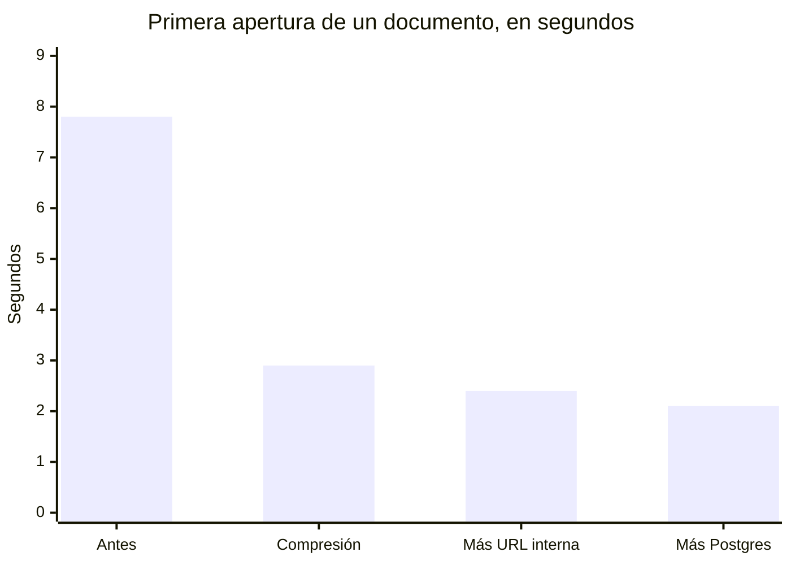

# 4. Rendimiento

La pregunta inicial fue si el correo podía ser instantáneo y OnlyOffice "mil veces más rápido". La respuesta corta: no, y saber por qué ahorró mucho tiempo.

## Dónde estaba el techo

| Recurso | Medida | Veredicto |
|---|---|---|
| CPU | Ryzen 5 7600X, carga media 0,2 | Sobrada |
| RAM | 26 de 30 GB útiles en uso (32 instalados), 615 MB de swap | Parecía alarmante. Eran 15 GB de caché ZFS (ARC), que es exactamente lo que debe hacer |
| Discos | Dos discos SMR de sobremesa en espejo, con Postgres, PHP y OnlyOffice encima | **El techo.** Los SMR reescriben bandas enteras para cada escritura pequeña, justo el patrón de una base de datos |
| Red | Avisos internos de OnlyOffice a Nextcloud: 68 ms por Caddy y TLS, 26 ms directos | Mejorable, pero pequeño |
| Volumen | 741 correos, 204 eventos | Trivial. La lentitud no venía del tamaño |

Conclusión de la auditoría: cambiar Nextcloud por otra cosa sobre los mismos discos habría dado una mejora parecida a ajustarlo. Lo que tocaba era **dejar de pedir a los discos trabajo inútil**. Ver [la decisión 0001](decisiones/0001-afinar-antes-que-sustituir.md).

## Lo que se cambió

| Cambio | Efecto medido |
|---|---|
| `encode zstd gzip` en Caddy para la nube y el editor | `sdk-all.js` de OnlyOffice pasa de **28,9 MB a 5,1 MB**. La primera apertura de un documento fuera de casa pasó de unos 7,8 s a 2,1 s |
| Cron de Nextcloud cada minuto | Tareas en segundo plano 5 veces más frecuentes |
| OPcache de 128 a 256 MB | Menos recompilación de PHP; tasa de aciertos estable por encima del 99 % |
| Postgres: `synchronous_commit=off`, checkpoints cada 15 min, `max_wal_size=4GB`, `wal_compression=on` | Es lo que más alivia las escrituras en disco duro. Coste asumido: en un corte de luz se pueden perder los últimos ~0,6 s de transacciones, sin corrupción. Ver [la decisión 0002](decisiones/0002-postgres-sin-commit-sincrono.md) |
| `StorageUrl` de OnlyOffice a la dirección interna | Sus avisos a Nextcloud ya no pasan por el proxy ni por TLS |
| `overwrite.cli.url` corregido | Los enlaces generados por cron dejan de apuntar a `localhost` |
| SnappyMail en lugar de Mail | Correo por IMAP en vivo, sin esperar al cron |
| Imágenes y apps retiradas | 24 GB menos en el pool y cuatro contenedores menos compitiendo por el disco |

## Lo que se descartó

- **Sacar Postgres al SSD de arranque.** Habría sido la mejora más grande, pero TrueNAS no está pensado para datos en el pool de arranque y una actualización del sistema puede llevárselos por delante.
- **Más RAM para OnlyOffice.** No le faltaba. Tenía `extra_hosts` hacia el NAS y ya evitaba la ida y vuelta por internet que se sospechaba al principio.
- **Afinar más Postgres.** Ya tenía 5 GB de `shared_buffers` y 26 GB de `effective_cache_size`. Tocarlo más no habría cambiado nada.

## Lo que sí cambiará el techo

Un NVMe para la base de datos y el código de las aplicaciones, y discos de NAS (CMR) en lugar de SMR para los datos. Está en la [hoja de ruta](10-hoja-de-ruta.md). Ningún ajuste de software sustituye a eso; lo que se hizo aquí fue llegar tan cerca del techo como se podía sin gastar un euro.

---

Anterior: [Arquitectura](03-arquitectura.md) · Siguiente: [Correo y calendario](05-correo-y-calendario.md)
