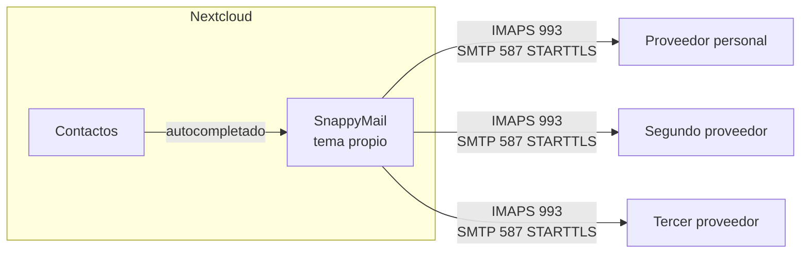
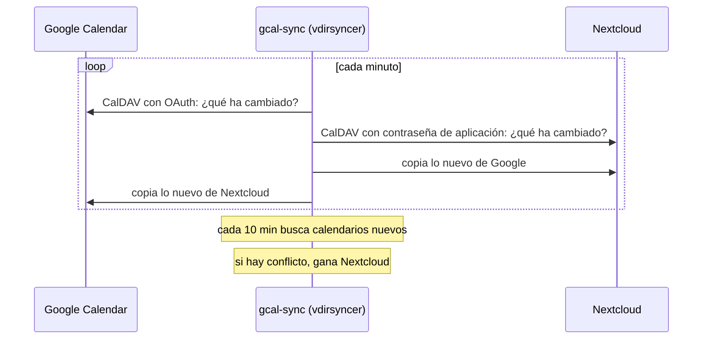

# 5. Correo y calendario

El objetivo era el de Google: correo, calendario, contactos, notas y documentos desde un mismo sitio. Nextcloud ya era ese sitio. Su correo no estaba a la altura, y su calendario vivía aislado del de Google.

## Correo: SnappyMail dentro de Nextcloud

**Por qué se cambió.** La app Mail de Nextcloud sincroniza por cron, no por IMAP IDLE, así que no avisa al instante. Nunca iba a ser inmediata. SnappyMail habla IMAP en vivo, es mucho más ligero y sigue apareciendo en la barra de Nextcloud. Ver [la decisión 0003](decisiones/0003-tema-propio-no-webmail-propio.md).

**Lo que hubo que hacer:**

| Problema | Solución |
|---|---|
| Una cuenta iba con IMAP 143 y SMTP 25 **sin cifrar** contra IPs públicas | Comprobado que el servidor admitía TLS (certificado válido) y configurado con 993 y 587 |
| Proveedores que rechazan la contraseña normal por IMAP | Contraseñas de aplicación, una por cliente, revocables por separado |
| Firmas que se guardaban como el HTML coloreado del editor de código | Escritas directamente en la identidad del servidor, no pegadas a mano |
| Correos que salían en texto plano | El ajuste personal `EditorDefaultType` estaba en `Plain` y pisaba el global |
| Sin memoria de destinatarios | Almacén de contactos activado en SQLite, más 137 contactos importados de Google a Nextcloud |

**El tema.** Los temas incluidos eran de otra época. Atelier es propio: fondo tinta, paneles sobrios, bordes finos, acento ámbar, diálogos con desenfoque y los correos HTML sobre un panel claro para que los diseñados con fondo blanco se lean bien.

## Calendario: Nextcloud y Google en los dos sentidos

No existe de serie. Nextcloud no habla OAuth con Google y Google no avisa a nadie cuando cambia un evento. Hace falta un tercero que consulte los dos lados cada poco y copie las diferencias.

**Cómo se montó, con seguridad:**

1. Copia de los calendarios en `.ics` antes de nada.
2. Calendarios **nuevos** emparejados (`Google · cuenta` en Nextcloud y `Nextcloud · Personal` en Google), sin mezclar con los existentes hasta comprobar que iba bien.
3. Primera pasada que no puede borrar nada en ninguno de los dos lados.
4. Las credenciales de Google nunca pasaron por la conversación: el JSON del cliente y el código de autorización se dejaron en una carpeta, se movieron a un directorio privado del NAS y se borraron los originales.
5. La app de Google en "producción" (sin verificar, uso personal), porque en "pruebas" el acceso caduca a los 7 días y la sincronización muere en silencio.

**Resultado.** 79 de 81 eventos de Google copiados en la primera pasada; los dos restantes eran reservas generadas por el correo de Google, que su CalDAV no deja leer. Creación en cualquiera de los dos lados visible en el otro en 20 a 60 segundos. Hasta el 4 de octubre, 3.352 ciclos seguidos sin un fallo propio.

**El parche.** Los eventos que Google genera solos (vuelos, hoteles) son de solo lectura. vdirsyncer intentaba escribirlos cada minuto y llenaba el log de errores. Un parche mínimo los marca como aviso una sola vez y no vuelve a intentarlo. Se aplica al construir la imagen: si un día deja de encajar, la construcción falla en lugar de sincronizar mal. Ver [la decisión 0004](decisiones/0004-vdirsyncer-no-n8n.md).

## Notas

Se valoraron Obsidian, Joplin, Memos y Collectives. Ninguno mejoraba lo suficiente a la app Notes de Nextcloud para lo que se usa. Se quedó la que había.

---

Anterior: [Rendimiento](04-rendimiento.md) · Siguiente: [Seguridad](06-seguridad.md)
