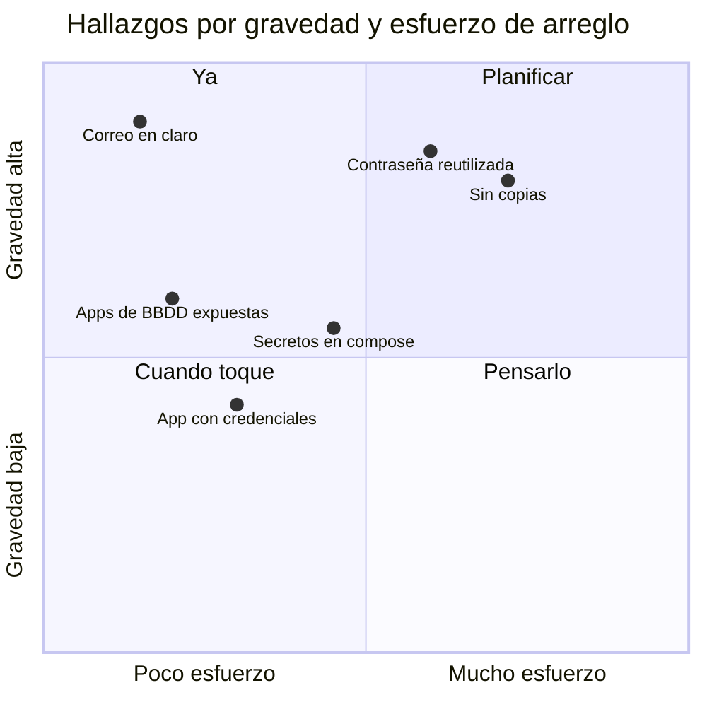

# 6. Seguridad

Ninguno de estos problemas se encontró buscando problemas de seguridad. Aparecieron mientras se arreglaba otra cosa: la velocidad, el correo, las copias. Es la lección principal del documento.

## Resumen

| # | Hallazgo | Gravedad | Cómo apareció | Estado |
|---|---|---|---|---|
| 1 | Credenciales de correo viajando en claro por internet | Alta | Configurando SnappyMail con capturas de la configuración vieja | Corregido |
| 2 | Una contraseña reutilizada como clave de caché, de base de datos y de administrador | Alta | Rotando la de Valkey | Corregido y rotado todo |
| 3 | Secretos en claro en los `compose.yaml` | Media | Auditoría de Nextcloud | Corregido |
| 4 | Secretos que acabaron en una conversación al mostrar ficheros | Media | Revisando la configuración del túnel y del panel | Rotados |
| 5 | Gestor de contraseñas y base de datos de Nextcloud sin ninguna copia | Alta | Comprobando qué copias había antes de borrar las mías | Corregido |
| 6 | Credenciales guardadas por una app desactivada | Media | Retirando la app Mail | Corregido |
| 7 | Dos clientes web de bases de datos publicados sin uso | Media | Limpieza de aplicaciones | Eliminados |

## Los importantes, contados

### 1. Correo en claro

**Qué.** Una de las cuentas se conectaba por IMAP en el 143 y SMTP en el 25, sin TLS, contra IPs públicas. Usuario y contraseña en claro por internet cada cinco minutos, desde hacía meses.

**Cómo se comprobó que había alternativa.** Antes de proponer nada, una conexión de solo lectura al servidor confirmó que ofrecía TLS en 993 y 587 con un certificado válido hasta 2027.

**Qué se hizo.** La cuenta pasó a 993 y 587 con cifrado, y la contraseña se cambió, porque llevaba tiempo expuesta.

### 2. La contraseña reutilizada

**Qué.** Al rotar la clave de Valkey apareció que era la misma que la de Postgres (en tres variables) y la del administrador de Nextcloud. Y que también estaba en los `compose` de n8n e Immich, en el panel y en una integración de Home Assistant.

**Qué se hizo.** La clave de Valkey se rotó en caliente, sin cerrar ninguna de las 113 sesiones (el procedimiento y el susto están en [Tropiezos](08-tropiezos.md#tres-de-ocho-peticiones-dieron-500)). El resto lo roté yo a mano después, servicio por servicio.

### 3. Secretos fuera del `compose.yaml`

Un `compose.yaml` se muestra en Dockge, se copia como respaldo, se pega en un chat para pedir ayuda. Un secreto ahí acaba saliendo. Las claves se movieron a ficheros con permisos `600` que el contenedor lee al arrancar, y `redis.config.php` las lee del fichero en lugar de la variable de entorno. Ver [la decisión 0008](decisiones/0008-secretos-fuera-del-compose.md).

### 5. Sin copias de lo que más duele

**Qué.** El gestor de contraseñas vivía en una carpeta que ninguna tarea de instantáneas cubría. La base de datos de Nextcloud (calendarios, contactos, índice de ficheros), tampoco. Lo que sí tenía instantáneas las hacía una vez al mes.

**Cómo apareció.** Al borrar las copias temporales de mis propios cambios, quise comprobar que no estaba dejando el sistema sin red. Lo estaba ya antes. Lo que se hizo está en [Copias](07-copias.md).

### 7. Clientes de bases de datos publicados

WhoDB y Adminer estaban detrás del proxy y del túnel, sin uso. Una aplicación web cuya función es abrir bases de datos no debería estar publicada nunca, y menos olvidada. Se eliminaron con sus redes, su DNS, su bloque de proxy y su tarjeta del panel.

## Principios que salieron de aquí

- **Ninguna credencial en claro por la red**, ni siquiera en la LAN si se puede evitar.
- **Una contraseña por cosa.** Una contraseña de aplicación por cliente, revocable sin tocar las demás.
- **Lo que no se usa, fuera.** No desactivado: borrado, con su proxy, su DNS y sus datos.
- **Mostrar ficheros es filtrar ficheros.** Las comprobaciones se hacen con hashes o nombres de variable, nunca con el valor.
- **Las copias temporales también son datos sensibles.** Se borran en cuanto dejan de hacer falta.

---

Anterior: [Correo y calendario](05-correo-y-calendario.md) · Siguiente: [Copias](07-copias.md)
