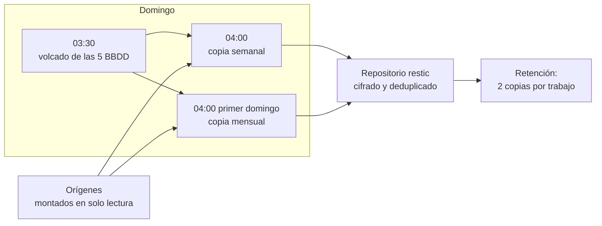
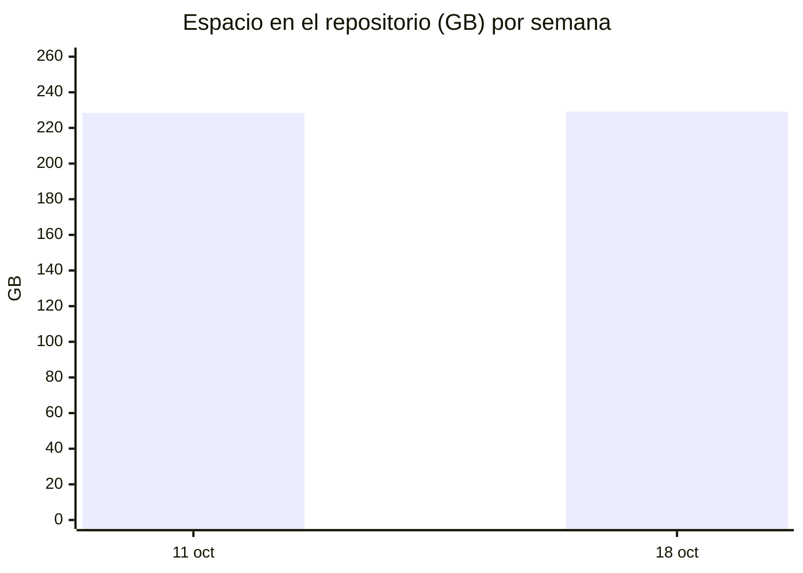

# 7. Copias

Requisitos de partida: copias semanales de lo importante, mensuales de lo secundario, siempre en domingo a las 04:00 y como mucho dos copias guardadas, para que no pesen.

## El circuito completo

**Por qué volcar antes de copiar.** Copiar la carpeta de un Postgres en marcha da una copia que puede no arrancar. Media hora antes, un script de TrueNAS hace `pg_dump` comprimido de las bases de Nextcloud, Immich, n8n y Securo, y una copia consistente de Vaultwarden. La copia de las 04:00 guarda esos volcados, no las carpetas vivas.

## Qué entra en cada trabajo

| Trabajo | Cuándo | Qué copia | Tamaño de la prueba |
|---|---|---|---|
| Importante | Domingo 04:00 | Vaultwarden, Nextcloud (ficheros, configuración, apps, temas, SnappyMail), volcados de BBDD, Home Assistant, Dockge, gcal-sync, AdGuard, la VPN y los **originales** de Immich | 4 GB sin fotos; 228 GB con ellas |
| n8n | Domingo 04:00 | Datos de n8n, sin su Postgres en caliente (va en el volcado) | 481 MB, 129 MB tras deduplicar |
| Secundario | Primer domingo del mes, 04:00 | OnlyOffice, web personal, Arcane, Syncthing, AdGuard `workdir` | 988 MB |

De Immich se copian `library`, `upload` y `profile`. Las miniaturas y los vídeos recodificados no: se regeneran solos y ocupan casi tanto como los originales.

## Por qué solo dos copias

Una copia protege de un fallo. Dos protegen de un fallo que se descubre tarde: si el domingo se copia algo ya roto, la del domingo anterior sigue bien. Con restic y deduplicación, la segunda copia ocupa solo lo que cambió. Más de dos solo tiene sentido con más espacio, y está en la [hoja de ruta](10-hoja-de-ruta.md). Ver [la decisión 0007](decisiones/0007-restic-con-retencion-corta.md).

## El simulacro

El 18 de octubre:

1. Restauración del último volcado de Nextcloud en un Postgres efímero, sin red, en otro contenedor.
2. Comparación de recuentos con la base viva: calendarios, eventos, contactos y ficheros indexados. Idénticos salvo los cambios de esa semana.
3. Restauración de Vaultwarden en un contenedor aparte, en solo LAN, y apertura de la bóveda con el cliente. Correcta.
4. Restauración de una carpeta de fotos al azar y comparación de sumas SHA-256 con los originales. Idénticas.
5. Borrado de todo lo restaurado.

Tiempo total: 38 minutos. El paso que más tardó fue encontrar la clave del repositorio, que es justo el motivo de hacer simulacros.

## Lo que todavía no cubre

- **La primera copia completa tarda horas** porque sube las fotos enteras. Las siguientes son incrementales y tardan minutos.
- **La clave del repositorio** tiene más de una copia, y ninguna depende solo del NAS.

---

Anterior: [Seguridad](06-seguridad.md) · Siguiente: [Tropiezos](08-tropiezos.md)
