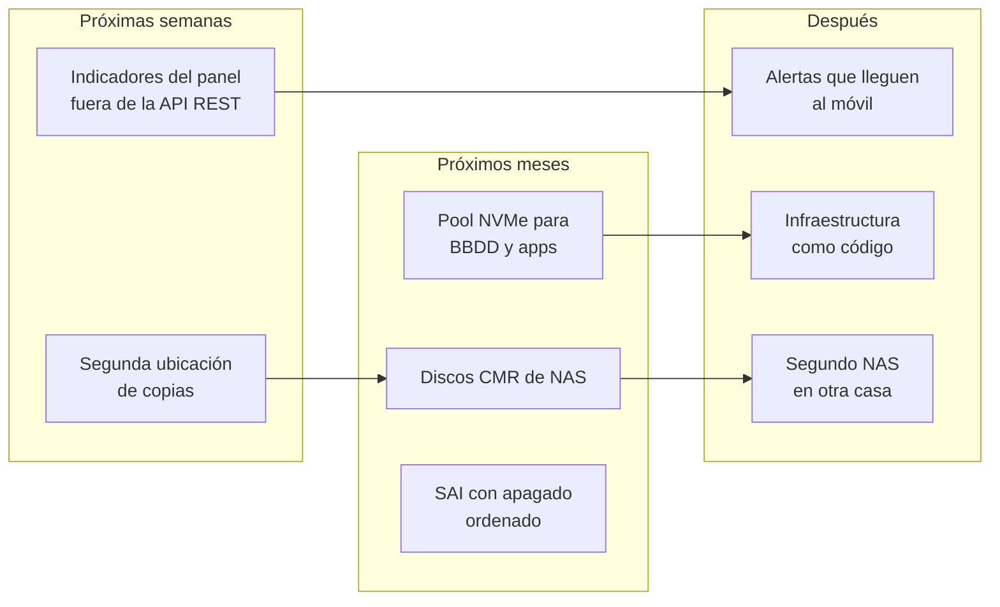

# 10. Hoja de ruta

Ordenada por lo que más reduce el riesgo, no por lo que más luce.

## Próximas semanas

### Segunda ubicación de copias

**Por qué es lo primero.** Una copia solo protege de verdad si sobrevive a lo que le pase a la máquina: un incendio, un robo o la muerte de los dos discos a la vez.

**Cómo.** Un segundo repositorio restic en almacenamiento de objetos compatible con S3, cifrado en origen con una clave distinta. Solo el trabajo "Importante" y los volcados, que sin fotos caben en pocos GB. Las fotos, a un disco externo que se conecta una vez al mes y se guarda fuera de casa.

### El panel, fuera de la API REST de TrueNAS

TrueNAS va a retirar su API REST en favor de su API por WebSocket. Los indicadores del panel que leen CPU, memoria, pool y discos la usan. Hay que migrarlos **antes** de actualizar el sistema, o el panel se quedará en blanco el día de la actualización.

## Próximos meses

### Pool NVMe para bases de datos y aplicaciones

La mejora de rendimiento que ningún ajuste puede sustituir. Un NVMe en espejo para Postgres, el código de Nextcloud, la caché de OnlyOffice y los modelos de Immich. Los datos grandes (fotos, ficheros) se quedan en el pool de discos. Estimación: la web de Nextcloud entre 3 y 5 veces más ágil, y el fin de los atascos cuando Docker escribe.

### Discos de NAS

Sustituir los dos discos SMR de sobremesa por discos CMR pensados para funcionar 24 horas. El espejo permite hacerlo de uno en uno, con *resilver* entre medias y sin parar nada. Los discos viejos, limpios, pasan a ser el disco externo de la segunda ubicación de copias.

### SAI con apagado ordenado

Postgres funciona con `synchronous_commit=off`: un corte de luz puede perder los últimos ~0,6 s de transacciones. Un SAI que avise a TrueNAS para apagar en orden convierte ese riesgo pequeño en ninguno.

## Después

- **Alertas que lleguen al móvil.** Que una copia fallida, un disco con sectores reasignados o un dominio caído avisen solos, por n8n, en lugar de descubrirlos al abrir el panel. La web caída durante semanas no se habría quedado así.
- **Infraestructura como código.** Las pilas de Docker Compose, el Caddyfile y las reescrituras DNS en un repositorio Git privado, con los secretos fuera. Reconstruir el NAS desde cero pasaría de una semana de memoria a una tarde de comandos.
- **Segundo NAS en otra casa.** Réplica ZFS cifrada por la malla privada. Es la segunda ubicación definitiva, y la más cara. Solo si las demás se quedan cortas.

## Lo que no está en la hoja de ruta, a propósito

- **Correo entrante propio.** Alojar un servidor de correo en casa implica puerto 25, DNS inverso y pelear con la reputación de una IP doméstica. Los proveedores actuales lo hacen mejor; el NAS solo los lee.
- **Kubernetes.** Una sola máquina, un solo administrador. Docker Compose es la herramienta adecuada.
- **Más aplicaciones porque sí.** openGym enseñó que añadir una aplicación cuesta una tarde y quitarla bien, otra. Antes de instalar, la pregunta es quién la va a usar cada semana.

---

Anterior: [Lo aprendido](09-lecciones.md) · Siguiente: [Registro de decisiones](decisiones/README.md)
