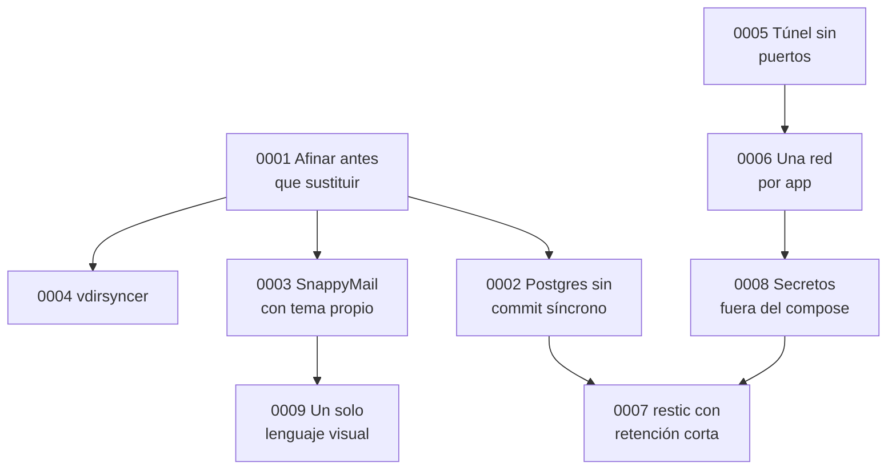

# Registro de decisiones

Cada fichero recoge una decisión importante con el formato de Michael Nygard: contexto, decisión y consecuencias (las buenas, las malas y las neutras, juntas para no esconder ningún coste). Añado las alternativas descartadas, porque en varias el "no" fue tan importante como el "sí".

Las decisiones aceptadas no se editan. Si cambian, se escribe una nueva que sustituye a la anterior y la vieja lo indica en su estado.

| # | Decisión | Estado |
|---|---|---|
| [0000](0000-registrar-decisiones.md) | Registrar las decisiones | Aceptada |
| [0001](0001-afinar-antes-que-sustituir.md) | Afinar Nextcloud antes que sustituirlo | Aceptada |
| [0002](0002-postgres-sin-commit-sincrono.md) | Postgres sin commit síncrono sobre discos duros | Aceptada, provisional hasta el NVMe y el SAI |
| [0003](0003-tema-propio-no-webmail-propio.md) | SnappyMail con tema propio, no un webmail propio | Aceptada, sustituye a un webmail construido y retirado |
| [0004](0004-vdirsyncer-no-n8n.md) | vdirsyncer para el calendario, no un flujo de n8n | Aceptada |
| [0005](0005-tunel-sin-puertos-abiertos.md) | Túnel saliente, cero puertos abiertos | Aceptada |
| [0006](0006-una-red-por-aplicacion.md) | Una red de Docker por aplicación | Aceptada |
| [0007](0007-restic-con-retencion-corta.md) | restic con dos copias por trabajo | Aceptada |
| [0008](0008-secretos-fuera-del-compose.md) | Secretos fuera del `compose.yaml` | Aceptada |
| [0009](0009-un-solo-lenguaje-visual.md) | Un solo lenguaje visual para todo | Aceptada |

Cómo se apoyan unas en otras:

---

Anterior: [Hoja de ruta](../10-hoja-de-ruta.md) · Volver al [inicio](../../README.md)
